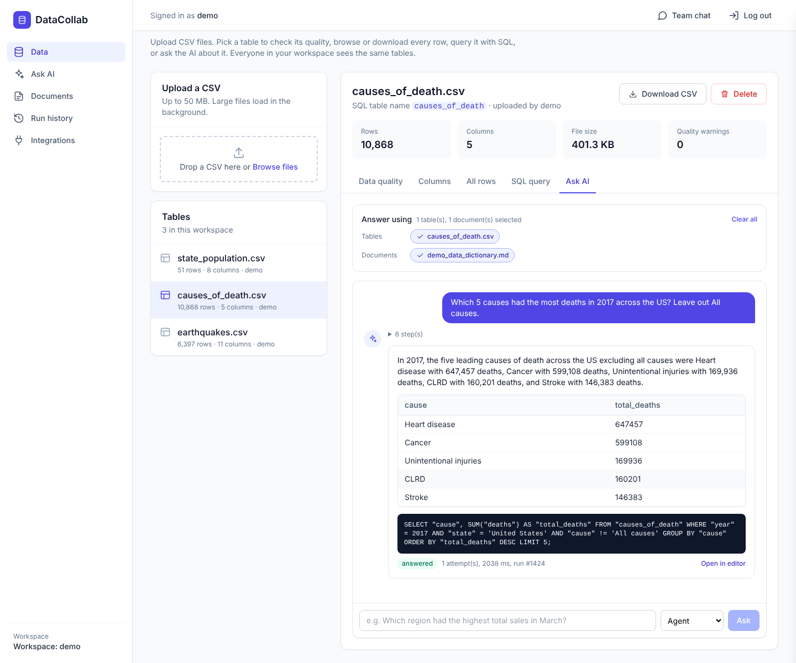
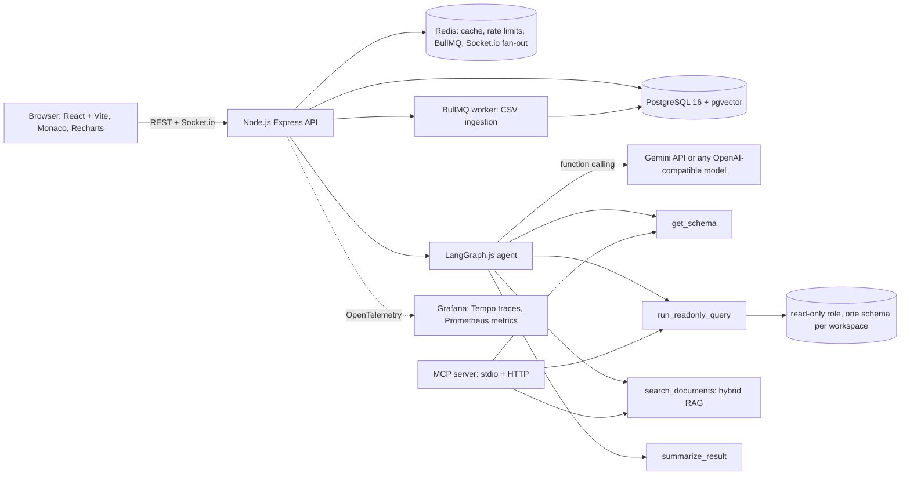
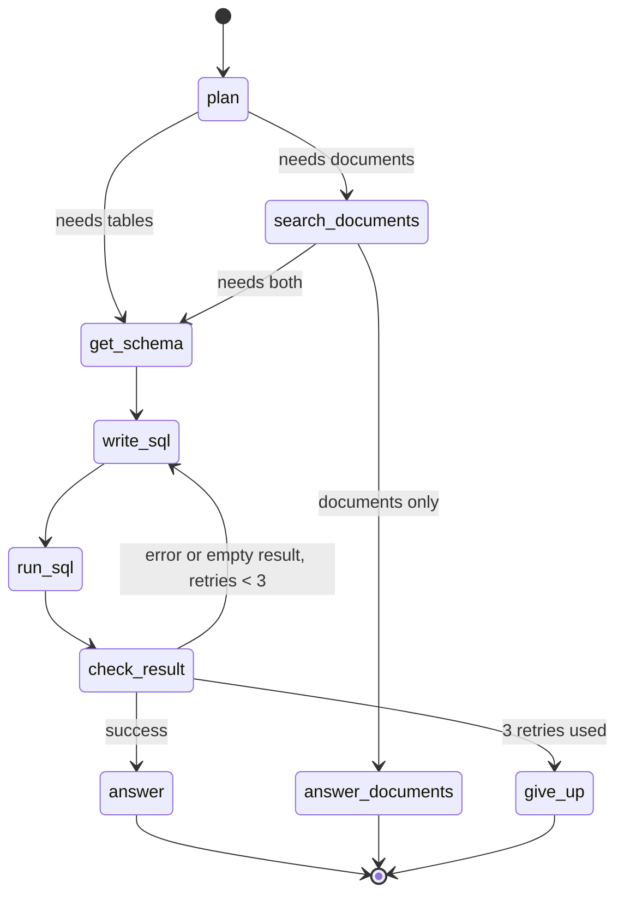
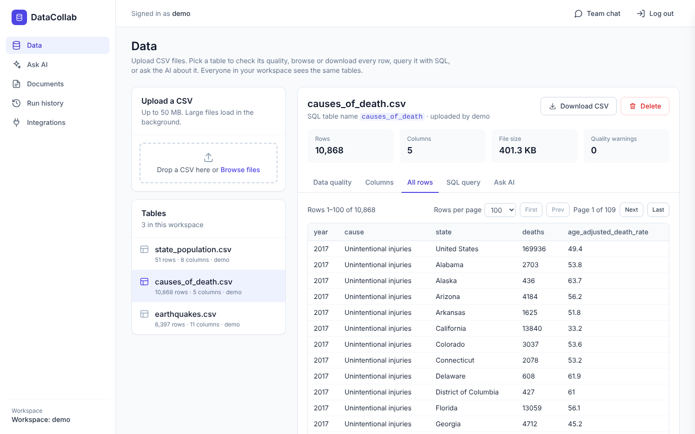
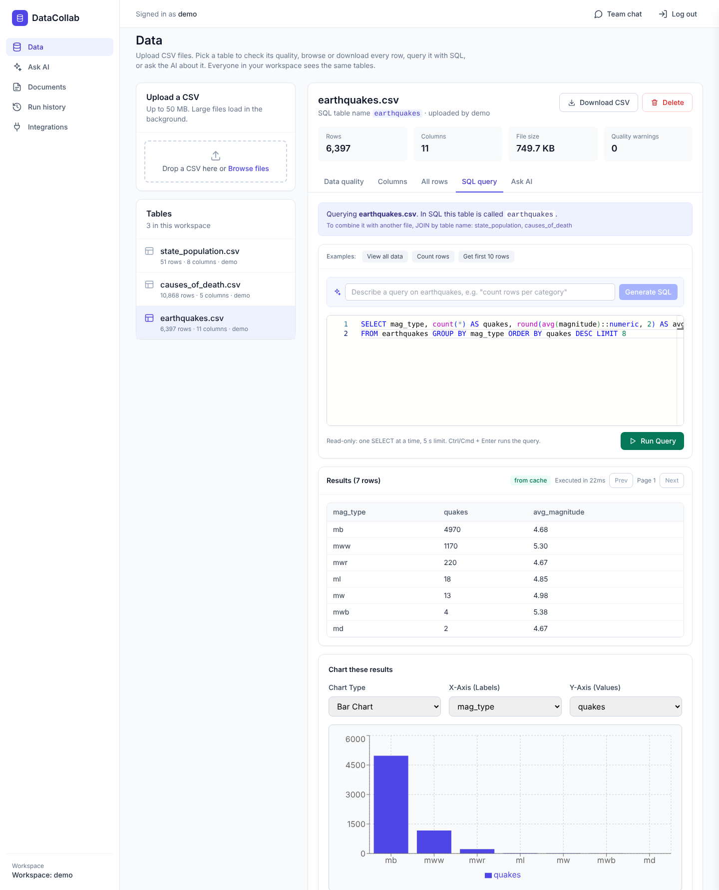
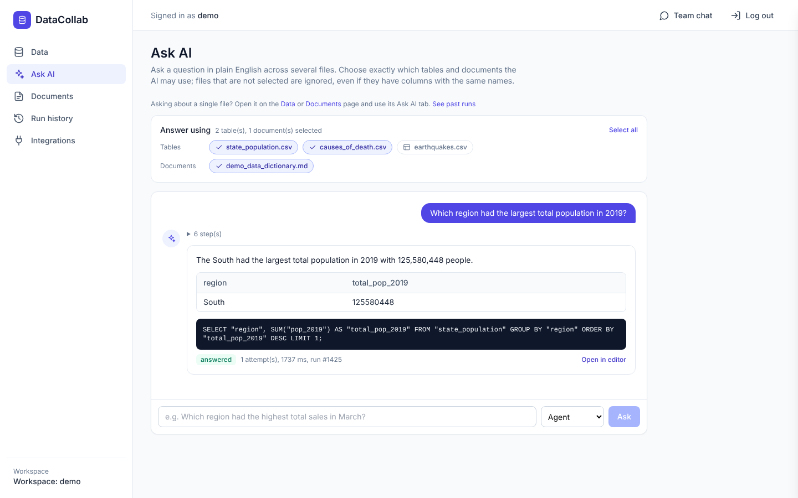
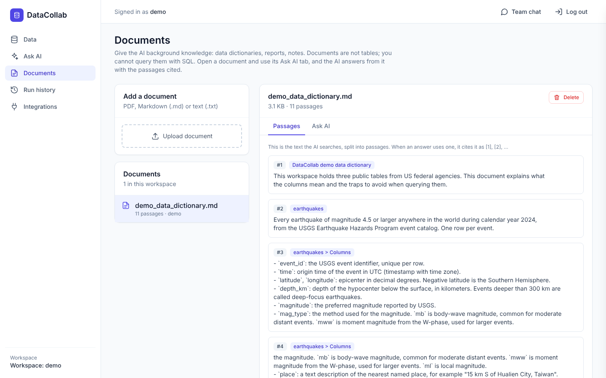
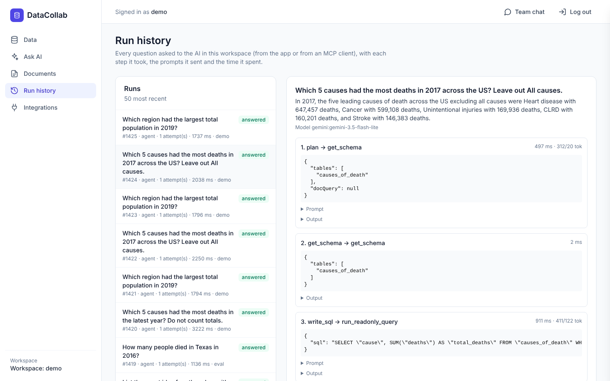
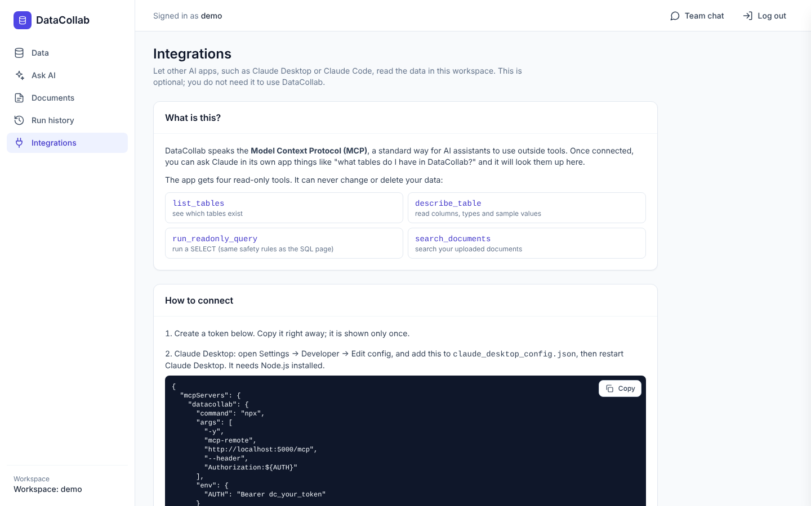

# DataCollab: collaborative SQL workspace with an AI data agent

[](https://github.com/Jinam-Shah/DataCollab/actions/workflows/ci.yml)
[](LICENSE)

Teams upload CSVs and documents, query them with SQL or plain English, chart the results and
chat in real time. An AI agent built with LangGraph.js reads the schema, writes SQL, runs it
through a read-only safety layer, retries on errors, and answers with the SQL it used and
citations to documents. You choose exactly which tables and documents it may use. The same
tools are available to any MCP client.



**Live demo:** https://data-collab.vercel.app · demo login `demo@datacollab.dev` / `demo1234`.
Hosted on free tiers (Vercel, Render, Neon); the API sleeps when idle, so the first request can
take about a minute.

---

## Architecture





## Features

**Data**
- CSV upload with type inference over every row (integer, float, date, timestamp, text) and a **quality report**: empty %, mixed types, duplicates, numeric and date ranges, with warnings before the first query.
- Files over 1 MB load in the background through **BullMQ**, with live progress over Socket.io and retries with backoff.
- Each table has tabs for its quality report, columns, **all rows** (paged), a **SQL editor** (Monaco, paginated results, bar/line/pie charts) and **Ask AI**. **Download CSV** rebuilds the file from the database with the original headers, streamed in batches.

**AI**
- **Agent** (LangGraph.js, LangChain.js tools with zod schemas, Gemini function calling): plan → schema → SQL → run → check, with up to 3 retries that feed the database error back. Steps stream to the UI; every answer shows its SQL with *Open in editor*.
- **Scoped questions**: ask from a table or a document page, or pick sources on the Ask AI page. The API takes `fileIds` / `documentIds`, keeps only ids from the caller's workspace, shows the model only the selected tables and searches only the selected documents, so same-named columns in other files cannot get mixed in.
- **Single-shot** NL-to-SQL kept as a baseline mode.
- **RAG** over PDF/Markdown/TXT: chunks with page and section references, local `all-MiniLM-L6-v2` embeddings, **hybrid search** (pgvector HNSW + PostgreSQL full-text, reciprocal rank fusion), clickable citations.
- **Tracing** of every run and step (prompt, tool input/output, error, latency, tokens) in `agent_runs` / `agent_steps`, with a Run history page and an analysis notebook.
- **MCP server** (`list_tables`, `describe_table`, `run_readonly_query`, `search_documents`) over stdio and Streamable HTTP, with workspace API tokens. See [docs/MCP.md](docs/MCP.md).

**Safety and operations**
- Model- and user-written SQL runs as a **read-only role** that can only see one workspace's schema, with a 5 s statement timeout, a **single-statement check** using PostgreSQL's own parser, a keyword denylist and a 1000-row cap. See [docs/SECURITY.md](docs/SECURITY.md).
- **Redis** query cache keyed by data version (never stale) and per-user sliding-window **rate limits**.
- **OpenTelemetry** traces and metrics with a provisioned **Grafana** dashboard. See [docs/OBSERVABILITY.md](docs/OBSERVABILITY.md).
- Real-time chat, upload and query events in authenticated per-workspace Socket.io rooms (Redis adapter across replicas).
- **Invite-only workspaces**: joining a workspace that has members needs its invite code (random, constant-time check), shown on the Team page with the member list; any member can replace it.

## Results

All numbers are measured; commands and environments are in [METRICS.md](METRICS.md).

| What | Result |
|---|---|
| Agent accuracy, 40-question eval set, Gemini (`gemini-3.5-flash-lite`) | single-shot 92.5% → agent **95.0%** (hard questions 76.9% → 84.6%), median 1.1 s per question |
| Held-out set, 20 new questions, Gemini | single-shot 95.0%, agent **95.0%** (19/20 each), in line with the development set |
| Same eval, local `qwen2.5-coder:7b` | single-shot 77.5% → agent 80.0% → agent + column profiles 82.5% |
| Significance | no configuration difference is significant on 40 questions for either model (McNemar p ≥ 0.5); the model choice matters far more |
| Document retrieval hit rate @5, held-out questions | hybrid **80%** vs vector-only 60% (MRR 0.602 vs 0.567) |
| CSV ingest | 100,000 rows in 2.5 s end to end; the API answers the upload in about 50 ms (background job) |
| Query cache | p95 126.6 ms → **15.5 ms**, 108 → 997 req/s (aggregate over 100K rows, 10 connections) |
| Kubernetes autoscaling (local kind cluster, 40 concurrent workers for 180 s) | API **2 → 6 replicas** within a minute at 218–230% of the CPU target; 76,006 requests, 0.03% failed |
| Tests | 150 backend (Jest + Supertest, real PostgreSQL and Redis; 77.0% line coverage), 23 frontend (Vitest), 6 end-to-end (Playwright, including a two-browser real-time sync test with an invite code) |

The 40-question set was used while building the agent, so it shows differences between
configurations; the 20-question held-out set was written afterwards to check those numbers carry
over to new questions.


## Tech stack

| Area | Tools |
|---|---|
| Frontend | React 19, Vite, Tailwind, Monaco, Recharts, Socket.io client |
| Backend | Node.js 22, Express, TypeScript (gradual, `allowJs`), Socket.io, BullMQ, ioredis |
| Data | PostgreSQL 16 + pgvector, libpg-query, Redis |
| AI | LangGraph.js, LangChain.js, `@langchain/google-genai` (Gemini), OpenAI-compatible models via Ollama, transformers.js embeddings, MCP TypeScript SDK |
| Quality | Jest, Supertest, Vitest, React Testing Library, Playwright, ESLint, Prettier |
| Ops | Docker, Docker Compose, GitHub Actions, Kubernetes (kind, Kustomize, HPA), Terraform, OpenTelemetry, Grafana |

## Run it locally

### With Docker Compose (everything)

```bash
docker compose up --build
docker compose exec api node dist/scripts/seed_demo.js   # optional demo data
```

App: http://localhost:3000 · API: http://localhost:5000. Add the observability stack with
`docker compose -f docker-compose.yml -f docker-compose.observability.yml up --build`
(Grafana on http://localhost:3001).

### Without Docker

Prerequisites: Node.js 22, PostgreSQL 16 with the `pgvector` extension, optionally Redis, and a
[Gemini API key](https://aistudio.google.com/app/apikey) (free). Set `GEMINI_MODEL=gemini-3.5-flash-lite` for the highest free-tier rate limit.

```bash
# Backend
cd backend
npm install
cp .env.example .env          # set DATABASE_URL, DATABASE_READER_URL, JWT_SECRET, GEMINI_API_KEY
createdb datacollab
npm run migrate               # creates tables, the read-only role, pgvector
npm run seed:demo             # optional: demo account and public dataset
npm run dev                   # API on http://localhost:5000
npm run worker                # only if REDIS_URL is set

# Frontend
cd ../frontend
npm install
cp .env.example .env          # VITE_API_URL=http://localhost:5000
npm run dev                   # http://localhost:3000
```

To use a free local model instead of Gemini: `LLM_PROVIDER=openai OPENAI_BASE_URL=http://localhost:11434/v1 OPENAI_MODEL=qwen2.5-coder:7b` with [Ollama](https://ollama.com).

## Tests and evaluation

```bash
cd backend && npm test                 # Jest + Supertest (needs PostgreSQL; TEST_DATABASE_URL)
cd frontend && npm test                # Vitest
cd frontend && npx playwright test     # end to end, starts its own API and frontend
cd backend && npm run eval             # agent evaluation (see eval/run.ts for options)
cd backend && npm run eval -- --set eval/sql_holdout.jsonl   # held-out SQL questions
cd backend && npm run eval:retrieval   # document retrieval evaluation
```

CI runs lint, format, typecheck, all three test suites, a Docker build, Kubernetes manifest
validation and `terraform validate` on every push and pull request.

## Deployment

- **Free hosting:** `infra/terraform` defines Neon, Upstash, Render and Vercel. [infra/terraform/README.md](infra/terraform/README.md) lists the steps, including the manual ones.
- **Continuous deployment:** `.github/workflows/deploy.yml` deploys `main` after CI passes. It needs the repository secrets `RENDER_DEPLOY_HOOK_URL` (API) and, optionally, `VERCEL_TOKEN`, `VERCEL_ORG_ID`, `VERCEL_PROJECT_ID` (frontend; otherwise Vercel's own Git integration deploys it). Without a secret, that job is skipped.
- **Kubernetes:** `make k8s-up` (or the PowerShell steps in [k8s/README.md](k8s/README.md) on Windows) runs everything on a local kind cluster, with an autoscaler on the API. Run end to end on a laptop: under load the API scaled from 2 to 6 replicas within a minute.

## Documentation

| Document | Contents |
|---|---|
| [docs/AUDIT.md](docs/AUDIT.md) | What the project looked like before the upgrade, and the bugs found |
| [docs/SECURITY.md](docs/SECURITY.md) | Threat model and what each SQL control does and does not prevent |
| [docs/DECISIONS.md](docs/DECISIONS.md) | Design decisions with the options considered |
| [METRICS.md](METRICS.md) | Every measured number, with environment and command |
| [docs/MCP.md](docs/MCP.md) | Connecting MCP clients |
| [docs/OBSERVABILITY.md](docs/OBSERVABILITY.md) | Traces, metrics and the dashboard |

## Known limitations

- Any member can create a new invite code, but members cannot be removed yet, and there are no owner or admin roles.
- JWTs live in `localStorage` for 7 days; refresh tokens in httpOnly cookies are not implemented.
- The held-out SQL set is small (20 questions), so it can only show that the development numbers are not overfitted, not separate configurations.
- The live deployment was set up by hand in the provider dashboards; `infra/terraform` is validated in CI but has not been applied. The Kubernetes setup runs on a local kind cluster only (no hosted cluster).
- On free hosting, uploads are ingested in the API process, and an upload in progress is lost if the instance spins down.
- Choosing tables for the AI limits what the model is shown, not what SQL may run: a query that names another table in the workspace by hand still runs, read-only.
- The frontend bundle is about 915 KB gzipped because Monaco is bundled.

## Screenshots

Taken from a local run with the demo dataset and Gemini (`gemini-3.5-flash-lite`).

| | |
|---|---|
|  |  |
|  |  |
|  |  |
|  |  |

## Author

**Jinam Shah** · [GitHub @Jinam-Shah](https://github.com/Jinam-Shah)

## License

MIT
